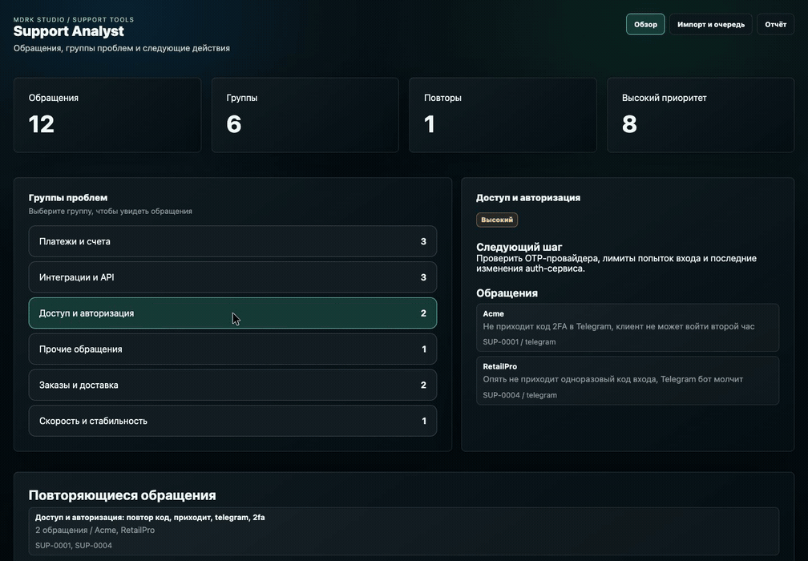

# Support Analyst

Инструмент разбора обращений: импорт, категории проблем, повторяющиеся сообщения и отчёт для команды.

Автор: [Марк / MDRK Studio](https://mdrkstudio.ru).

<picture>
  <source media="(prefers-reduced-motion: no-preference)" srcset="docs/demo.gif">
  
</picture>

## Возможности

- Импорт JSON, CSV с запятыми или точками с запятой, многострочные поля в кавычках и обычный текст.
- Категории проблем и приоритеты обращений.
- Выбор группы, просмотр исходных сообщений, поиск и фильтр приоритета.
- Поиск похожих повторяющихся обращений.
- Скачивание Markdown и JSON, копирование отчёта.
- Пустое состояние и сообщения об ошибках импорта.

## Запуск

Node.js 22.12+:

```bash
npm ci
npm run dev
```

Открой http://127.0.0.1:5187. Для production-сборки: `npm run build`, затем `npm run preview`.

Открой «Импорт и очередь», загрузи `examples/tickets.csv` или `examples/tickets.json`. Можно вставить строки:

```text
email | Company A | Оплата списалась дважды | high
web | Company B | Оплата списалась дважды | high
```

JSON: массив объектов с `text`, `customer`, `source`, `priority` либо объект с массивом `tickets`. CSV использует те же заголовки; также поддерживаются `текст`, `клиент`, `канал`, `приоритет`. Приоритет: `critical`, `high`, `normal`, `low`. Дата и исходный ID необязательны. Внутри анализа сообщения получают уникальные номера, исходный ID сохраняется в `original_id`.

## Как устроен

React и Vite. Категории определяются ключевыми словами, повторы - сигналами и сходством слов. Рекомендации задаются правилами. Для изменения правил открой `src/lib/supportAnalysis.js`.

Импорт заменяет текущую выборку. До 2000 обращений и 2 МБ за раз. Анализ выполняется в браузере без отправки сообщений на сервер; после закрытия страницы данные не сохраняются. Ошибка ввода не стирает последний успешный результат.

## Лицензия

Авторский код - [PolyForm Noncommercial 1.0.0](LICENSE). Некоммерческое использование, изменения и распространение разрешены по её условиям. Сохраняйте LICENSE и [NOTICE](NOTICE).

Для коммерческого применения нужно разрешение [MDRK Studio](https://mdrkstudio.ru/contacts). Сторонние зависимости и ресурсы сохраняют собственные лицензии.
